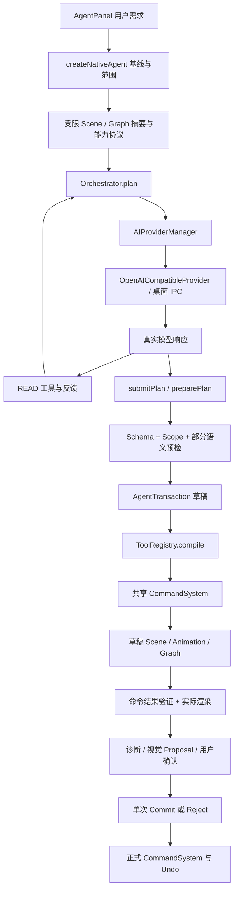
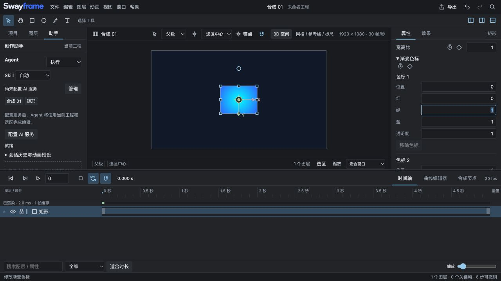

# Swayframe Agent 根因审计报告

审计日期：2026-10-11；业务基线：0.9.26，Git 快照 `bd2d82ca11db0f3327ad1d77cd16d7c21bcc4eb7`。
诊断分支：`codex/diagnose-0.9.26-20261011-124555`。原工作区、未提交修改和现有工程均保留。本轮未修改业务实现。
证据等级：CONFIRMED=代码及受控/真实运行证据；SUSPECTED=有依据但缺因果验证；UNVERIFIED=未验证；NOT A PROBLEM=在明确测试范围内正常。用户原始调用缺日志时另标 UNCONFIRMED。

## 1. Executive Summary

**Overall Status: DEGRADED。主要来源为 I：多个层级共同造成，当前已确认的重点是 C Tool Contract、D Planner、E Execution Runtime。** 历史真实调用另有 A 模型规划错误。B Provider 的诊断/恢复存在缺口，但未发现其将合法参数错误转换；已测 F Command、G Draft/Transaction、H Renderer 基础路径正常。

症结是：结构合法不等于参数语义/目标合法，含 READ 的计划停止后续语义预检；到执行阶段才暴露错误，执行阶段又缺少有限纠错。这能复现“先分析正常，实际编辑失败”的故障链。早期修补了单个工具协议、JSON 恢复及能力说明，未完整覆盖这条跨阶段链，因此不能用单个工具修复或 566 个测试通过推断 Agent 已可靠。

当前真实 DeepSeek 完成 18/18 个简单任务，4 类基础任务各独立重复 3 次，其余 6 类各一次；实际 Scene、18 张原生 Canvas PNG、整体 Undo 均验证。这个结果不能冒充复杂创作或参考图复刻成功率。历史 0.9.24 Cubic 复刻初稿加两轮视觉调整仍失败。本轮未再发送参考图，未复验该复杂任务。用户所说原始 createText / 连续两次 setFill 错误均无可匹配的原始调用参数，原始事件原因为 **UNCONFIRMED**。

建议 **PATCH + PARTIAL REFACTOR**：局部重构语义预检与执行纠错，修补错误反馈和结果验证；保留共享 Command、Scene、事务隔离、真实 Renderer、Provider 完整响应检查。无全面 REPLACE 的证据。未复现 P0 数据损坏；此次 P0 调查优先级不等于已证明 P0 缺陷。

## 2. Actual Agent Architecture

真实路径先规划读取，再提交结构化计划，随后在草稿内编译命令；不是模型直接修改 Scene。

| 层 / 源码入口 | 输入 → 输出 | 错误与状态依赖 |
|---|---|---|
| `src/ui/AgentPanel.tsx`；`src/ui/native-agent-controller.ts:45` createNativeAgent | 用户需求、选区、当前时间 → Runtime/Session | UI 展示 session/tool activity；捕获当前工程基线与作用域 |
| `src/agent/context-engine.ts`；`src/agent/creation-planner.ts:42` creationCapabilities | Scene/Graph/Registry → 有边界上下文、能力清单 | Scene 与 UI 状态分离；不传整个资源二进制 |
| `src/agent/orchestrator.ts:262` plan | 上下文、工具声明 → READ 调用、submitPlan | READ/纠错预算；Schema 修正发生于此，存在反馈截断 |
| `src/ai/provider-manager.ts` chat；`apps/desktop/electron/ai-service.ts:117` dispatch | ChatRequest → Provider response | 预算、超时、有限 Failover；桌面凭据在原生服务中使用 |
| `src/ai/openai-provider.ts:268` chat | messages/schema → text/toolCalls/usage | 保留 tool ID，解析 JSON/SSE，拒绝不完整结果；无 Scene 编辑 |
| `src/agent/session.ts:24`；creation-planner preparePlan | submitPlan → Structured Plan/Creation Task | steps 最大 100；args 外层为 record，具体工具二次校验 |
| `src/agent/tool-registry.ts:134/177` parsed/validatePlan | Plan+context → 校验结果 | 同源 Zod→JSON Schema；READ/effect_ 后不继续语义预演 |
| `src/agent/transaction.ts:36` execute | tool+args+最新草稿 → CommandResult | READ 读取 sandbox；WRITE compile→同一 CommandSystem；命令后置验证 |
| `src/agent/write-tools.ts` registerCoreWriteTools | 单工具参数 → 正式 Command[] | 坐标/颜色/时间转换；可抛语义错误 |
| `src/agent/tool-registry.ts:256` verifyResults | Commands+前后 Scene → 结果核验 | 验证 ID/值/Graph；组合 keyframe 命令存在误拒绝边界 |
| `src/agent/vision.ts:87` AgentSnapshotRenderer；`:21` VisualIntelligenceService | 草稿 → 原生 Canvas 图像/视觉 Proposal | 视觉服务只给 Proposal；执行成功与视觉目标分别检查 |
| native-agent-controller reviewDraft；transaction `:93` commit | 合法草稿 → 正式单次事务或拒绝 | 正式 Scene 基线 identity 已变则拒绝；Undo 恢复；失败丢弃草稿 |

未发现当前 Native Agent 绕过 Command 写 Scene。遗留 AgentBridge 用 snake_case；`src/ui/agent-controller.ts` 的 bridgeFor 无当前 Native UI 消费路径，保留在旧验收与历史接口，不能据此断言两个冲突执行器同时运行。

## 3. Historical Architecture Evolution

完整历史见 [AGENT_ARCHITECTURE_EVOLUTION.md](AGENT_ARCHITECTURE_EVOLUTION.md)。V0.1 从 archive 核验；0.9.0/7/19/20 有独立 Git 节点；0.9.23/24/26 来自文档、归档运行及同一未提交工作树快照，没有独立版本提交，不能臆造每版 Git diff。

历史演变总体保留了共享 Command 的正确边界，叠加 Native Planner、能力发现、视觉检查和重试策略。已确认的历史问题包括专业 Proposal 声明/内部 12 步限制不一致（0.9.7 已修）、后续 READ 越权/耗尽、错误 capability 名、路径手柄坐标误解、图节点未接 Output、视觉复刻验收失败。增加层数本身不是缺陷；现在仍残留的是语义与恢复边界没有贯穿全链。

## 4. Reproduced Failures

### 四层隔离结果

| 语义目标 / 正式工具 | A 普通 UI | B 正式 Command | C Tool Adapter | D 真实 DeepSeek |
|---|---|---|---|---|
| 文字 `createText` | 成功观察 | 成功 | 成功 | 3/3 |
| 原生径向填充 `setFill` | 成功观察，渐变可见 | 成功 | 成功 | 3/3 |
| 矩形 `createRectangle`（createShape 语义目标） | 成功观察 | 成功 | 成功 | 3/3 |
| 位置 `setPosition` | 成功观察 | 成功 | 成功 | 1/1 |
| 缩放 `setScale` | 成功观察 | 成功 | 成功 | 1/1 |
| 旋转 `setRotation` | 成功观察 | 成功 | 成功 | 1/1 |
| 两个位置关键帧 `addKeyframe` | 成功观察 | 成功 | 成功 | 3/3 |
| 高斯模糊 `addEffect` | 成功观察 | 成功 | 成功 | 1/1 |
| 图处理器 `createNode` | 成功观察 | 成功 | 成功 | 1/1 |
| 断开再连接 `connectNodes` | 成功观察 | 成功 | 成功 | 1/1 |

B 使用独立构造的 Command/共享 CompositingGraphService，未借助 Agent registry.compile 生成 B 输入；C 使用真实 AgentTransaction。B/C 10/10 对应 PNG 完全相同（`local-render-report.json`）。A 是同一隔离 origin 中顺序操作，通过 Inspector、时间轴、Graph DOM 与截图验证语义；没有取得独立导出的完整 Scene JSON，不能称 A/B 像素或序列化全量相等。B/C/D 为独立测试状态。blur 默认 radius=0，只验证节点插入、Scene 与图像保持，不证明非零模糊质量。

A 证据：`ui-evidence.json`、`ui-final-dom.txt` 及 ui-*.png。B/C：`local-render-report.json`、local-*.png。D：`live-report.json`、`extended-report.json`、完整脱敏 *-calls.json、每任务 session/Scene/PNG。18/18 PNG 已逐张人工查看；不据此判定参考图相似度。

### setFill / createText 受控失效

合法 fill 示例：`{layerId, color:{r:0,g:0.5,b:0.5,a:1}, gradient:"radial", radialParameters:{center:{x:0.5,y:0.5},radius:0.8}}`。通过 schema、编译、Scene、真实渲染。

缺少 color、CSS 字符串色、超范围色由结构校验拒绝并保留具体 field/expected/received；不是“合法参数被错误拒绝”。radial radius=-1、未知参数 foo、center 数组被外层 animValue 接受，到 definition 语义检查才拒绝。camera 不支持 fill，工具声明未显式枚举目标类型，compile 才发现。fill 的 center 是归一化坐标，与 transform.position 像素坐标不同；当前合法案例转换正确。全部原始参数/错误见 `local-probes.json:fillInvalid/boundaries`。

计划 `inspectLayer(validId) → setFill(radius=-1)` 被 validatePlan 接受，执行期失败，不触发第二次模型参数纠正，正式 Scene 不变。createText `{content:22,fontSize:-1}` 可在规划中反馈；受控 Provider 下一次改为 `{content:"Recovered",fontSize:36}` 完成，两次相同无效参数则停止。当前错误反馈 JSON 被截断，但 field 摘要仍在，不能说所有诊断信息都已丢失。

初始 local-probes 的 undoRestoresBase 用对象 identity 比较，结果 false 不代表 Undo 内容错误；以独立 live/extended 的内容等价及实际状态核验为准，18/18 Undo 恢复。最初 B 复用 Adapter 编译命令也不足以独立隔离，后来以 local-render-report 的独立 B 输入替代。保留早期原始证据，不将脚本弱断言误报为产品缺陷。

### 用户原始错误与历史失败

从 023/024 原始 Provider 归档提取 265 条工具记录，包含重放/重复文件，不是 265 个独立试验；其中 164 条 setFill 未含 radialParameters。没有匹配用户最近连续两次错误的原始参数，不能归因为某个半径或颜色。原始 createText 失败参数也未获得。结论均 UNCONFIRMED。

历史真实日志确实包含 Layer Not Found、READ 越权/预算耗尽、未注册 capability path、绝对手柄被写成零坐标、复刻初稿及两轮修改仍未达到视觉目标。历史证据可证明当时问题存在，不能自动证明 0.9.26 仍以同一形式失败。

## 5. Tool Contract Findings

模型声明来自 Registry 中的同一 Zod；保存的 [tool-contracts.json](outputs/deep-agent-audit/tool-contracts.json) 是完整实际 schema。没有发现当前 createText 的 JSON Schema/Zod 字段漂移。存在“Schema 比支持的语义宽”的问题。

| 工具 | 字段/默认/单位/上下文 | Command 及风险 |
|---|---|---|
| createText | 必须 content；可选 fontSize 1..2000、fontFamily、alignment left/center/right、RGBA object 0..1；position 像素中心；默认合成中心和原生文字默认样式；严格拒绝 text/font_size 别名 | layer.create；fontSize/fontFamily 等转原生属性；目标为当前合成；已测一致 |
| setFill | layerId+color 必须；gradient none/linear/radial；endColor/radialParameters/time 可选；时间秒默认当前时刻；颜色转 RGBA 数组；radial center 归一化、参数 ID 原生定义 | layer.replace + property 命令；限 shape/solid/text；record 没有表达径向参数名称与范围；AGENT-003 |
| createShape | **没有这个正式工具名**。应使用 createRectangle/Ellipse/Polygon/Star 或 createLayer(kind)；宽高像素默认原生模型，position 中心 | 本轮以 createRectangle 验证相同“创建图形”目标；未知工具被拒绝是正确行为，不新增别名 |
| setPosition | layerId+value{x,y}；time 秒可选 | 共享动画编辑生成 base/keyframe 命令；二维目标、当前时刻依赖；合法案例一致 |
| setScale | layerId+value{x,y}；**比例因子**，2 对应 UI 200%；time 可选 | 局部绝对缩放及共享 pivot 补偿；3D 被 transformCommands 拒绝，而简要声明未说明只支持 2D |
| setRotation | layerId+value(number **度**)；time 可选 | 局部绝对旋转及 pivot 补偿；3D 限制同上，不代表 3D Scene/普通 UI 无法旋转 |
| addKeyframe | propertyId 或 layerId+property path；time 秒/value 必须；ID 可生成；默认 linear | keyframe.add/update；两种目标组合的互斥要求主要由编译器判定；值类型还受目标属性约束 |
| addEffect | layerId+kind(enum)；effectId 可选 | 共享 Graph createNode/插入；本次 GaussianBlur radius0，非全面效果渲染验收 |
| createNode | layerId+type（正式注册 capability）；nodeId/position/edgeId 可选 | processor 插入 Output 链；generator 可先 detached，需随后连线；type 外层是 string，具体能力/端口另验证；edgeId 必须当前真实值 |
| connectNodes | from/to 各 nodeId+portId；真实 Graph ID 与端口 | 适配到共享 connectPorts；已占用输入/循环/未知端口拒绝合理；不要猜测或复用过期 ID |

缺失字段/错误类型属于 Schema Invalid，未知层/属性为 Context Invalid，未注册类型为 Capability Missing；不能把它们统称一个参数错误。详细声明与实际模型参数见 *-calls.json；正式命令数组、目标快照见 local-render-report/local-probes。

## 6. Provider Adapter Findings

合法单调用、多调用、ID、工具结果映射、SSE 分块 JSON 拼接经过真实 Adapter 受控测试，未发现转换丢字段。DeepSeek/SiliconFlow/OpenRouter/Custom 四种 endpoint 的 schema/ID 保持一致；只有 DeepSeek 设置 thinking disabled，其他适配没有独立 Scene 编辑逻辑。不同模型最终走同一 Registry/Command/Transaction。

DeepSeek 是唯一 LIVE VALIDATED Provider；SiliconFlow/OpenRouter/Custom 只是受控协议测试，其他模型与服务兼容性 UNVERIFIED。缺 `[DONE]`、partial JSON、finish_reason=length 被安全拒绝，NOT A PROBLEM，不能放宽为执行半截工具参数。

已确认 HTTP 400 原始服务错误正文被取消并改为笼统配置错误（AGENT-008）；invalid_response 的重试依赖两条中文文案，SSE 中断不进入同类纠错（AGENT-009）。实时 37 请求没有 Provider 错误/超时，不能把这些受控边界直接归因为用户原始失败。

默认 idle 45 秒、总截止至少 180 秒；SSE chunk 刷新 idle。非流式 boundedText 对 body chunk 不逐块刷新是静态风险，未复现本轮超时，SUSPECTED。Failover 对 network/timeout/rate_limit/provider 类有限重试，不能当作语义参数修复。

## 7. Planner Findings

validatePlan 不是只做 JSON 检查：会检查注册工具、权限/作用域，并预演一部分确定性写入。**但第一处 READ/effect_ 之后直接 break**，后续结构正确但语义错误的写入进入执行。Forge 的真实产物需执行后获得，不能通过伪造节点解决；应显式区分 VERIFIED/DEFERRED，并按草稿阶段再次验证。

Native Plan max100；专业 Proposal 是 max12；READ budget12，外循环最多8轮，早期轮次后强制 submitPlan；命令累计最多500；不是所有 Agent 写任务统一只有12步。历史 READ 耗尽日志支持对应失败，不能仅因机制存在便推断其导致当前 setFill。

system 首次 109,707 字符，实际单请求约 4.6万输入 tokens；工具 schema 又进入 creationCapabilities，存在重复。开销 CONFIRMED，导致模型注意力下降/超时/预算耗尽的因果关系 SUSPECTED，缺少精简上下文对照试验。

## 8. Execution Runtime Findings

runSteps 的工具失败只记录并 throw，fail 丢弃草稿；规划纠错没有延伸到执行期（AGENT-002）。这保护正式 Scene，却无法自动恢复后期参数错误。允许重试应只针对可恢复语义/目标错误，以同一基线、最新草稿与明确预算重新规划；需防止重复创建或重复提交。

verifyResults 能核验 Layer/Property/Graph/Keyframe，不是空成功。但 keyframe.add→update 同 ID 的合法单 batch，验证器仍拿早先 added 值与最终值比较，导致 false rejection（AGENT-006）。没有证据说当前常规 addKeyframe 必然生成这种 batch；本轮3次真实关键帧任务全部通过。

## 9. Transaction / State Findings

`AgentTransaction.execute:36–92` 每次读取 sandbox 最新 Project；已验证 createText→inspectLayer→setPosition，新建层可见且可修改，正式 Scene 未被创建。假设“所有后续 READ 都读正式 Scene 导致找不到新层”在该路径是 NOT A PROBLEM。

commit `:93–113` 检查宿主基线身份，拒绝覆盖期间的外部编辑；ID 在已测草稿链稳定。18 个真实任务提交后整体 Undo 内容恢复。失败草稿丢弃，正式 Scene 保留。应 KEEP，不以放松基线校验“修好”过期状态失败。复杂跨合成/并发取消/长时资产导入尚未完整运行，UNVERIFIED。

## 10. Error Recovery Findings

规划 Schema 错误：结构化 issues 可保留；受控 Provider 改参数后第二次成功，同参数重复停止，NOT A PROBLEM。不是系统总复用旧参数。

三处信息/策略缺口：①普通 compile Error 包装只留 tool_failed+message，字段/参数/恢复性丢失；②规划纠错 details 字符截断成非法 JSON，1749→1600；③HTTP 非2xx正文丢失。UI AgentPanel 304–330 可显示失败 activity 的细节，不能笼统说 UI 全部吞错。执行期无重新调用模型是另一层缺口。

具体分支：SchemaInvalid→规划修正；ContextInvalid/CapabilityMissing→视出现阶段可能直接失败；CommandFailed→草稿拒绝；Renderer/visual→诊断/有限 refinement 或 reject；ProviderFailed→类型化 Provider 策略。建议统一 error envelope 的字段和阶段，保留原始 cause，但不要对任何错误一律重试。

## 11. Test Coverage Gaps

详见 [AGENT_TEST_COVERAGE_GAP.md](AGENT_TEST_COVERAGE_GAP.md)。本轮 baseline 144 文件/566测试全部通过；主分类 464 editor/core/IO/runtime、86 Agent、16 Provider/AI。主分类互斥，不能重复累加；Mock、多步、Scene、像素候选标签是文件级重叠筛选，不是精确断言覆盖统计。

566 中真实 Provider=0，Native Agent→实际 Canvas 的无 mock端到端验收=0。部分测试模拟 Tool Runtime/Canvas，因此可通过而无法证明真实工具或最终图像。纯像素算法测试仍有价值，不应称为假测试。现有通过只能证明被断言的边界；本轮独立诊断脚本与18真实任务不冒充已有CI覆盖。

## 12. Confirmed Root Causes

以下问题均在未修改业务实现的基线上确认。P1/P2是本报告技术严重度；修复路线图 P0..P3 是任务实施优先级，二者区别明确。

### AGENT-001 — Planner semantic preflight

- Status / Severity：**CONFIRMED / P1**。
- Module：Planner semantic preflight。
- File Path：`/Users/aphelion-01/Documents/Codex/2026-10-03/Swayframe_Diagnostics/0.9.26-20261011-124555/src/agent/tool-registry.ts`。
- Function / Class：`AgentToolRegistry.validatePlan`。
- Relevant Line Range：177–229（0.9.26 快照）。
- Reproduction Steps：inspectLayer(valid ID) → setFill(radial radius=-1)。
- Expected Behavior：明确标记尚未验证阶段，执行前在当前草稿做阶段预检并能反馈修正。
- Actual Behavior：validatePlan 接受；运行到 setFill 才失败。
- Evidence：`local-probes.json: boundaries.lateValidation / executionRecovery`（证据目录 `outputs/deep-agent-audit/`；原窄审计边界在 `outputs/diagnostic-0926/`）。
- Root Cause：第一处 READ/effect_ 步骤直接 break，后续写入只检查 Zod 外形，不再编译/检查目标与参数语义。
- Impact：读取或 Forge 混入计划后，合法 JSON 可以带着错误参数/目标进入执行；用户看到前面分析正常、后面编辑失败。
- Recommended Fix：局部重构阶段预检，区分 VERIFIED/DEFERRED；纯读取不应阻止后续确定性写入检查。Forge 依赖不能伪造，须在实际产物生成后再验证后续阶段。

### AGENT-002 — Execution recovery

- Status / Severity：**CONFIRMED / P1**。
- Module：Execution recovery。
- File Path：`/Users/aphelion-01/Documents/Codex/2026-10-03/Swayframe_Diagnostics/0.9.26-20261011-124555/src/agent/orchestrator.ts`。
- Function / Class：`AgentOrchestrator.execute / runSteps`。
- Relevant Line Range：647–694（0.9.26 快照）。
- Reproduction Steps：运行 AGENT-001 的两步计划。。
- Expected Behavior：对可恢复参数/上下文错误，在同一基线和最新草稿上做有限纠错，重复错误停止，最终只提交一次。
- Actual Behavior：模型调用1次，读取完成，setFill失败，直接failed，正式Scene不变。
- Evidence：`local-probes.json: boundaries.executionRecovery`（证据目录 `outputs/deep-agent-audit/`；原窄审计边界在 `outputs/diagnostic-0926/`）。
- Root Cause：纠错只发生在 plan()；runSteps 捕获工具异常仅记录并 throw，fail() 丢弃整个草稿，没有执行期可恢复字段错误反馈循环。
- Impact：规划成功不等于可执行；用户必须重新发送需求，前置分析/查询费用重付。
- Recommended Fix：局部重构执行期恢复边界；必要时由原基线重新建草稿并重放已验证命令，禁止对正式Scene局部提交或重试非幂等提交。

### AGENT-003 — Tool semantic contract

- Status / Severity：**CONFIRMED / P1**。
- Module：Tool semantic contract。
- File Path：`/Users/aphelion-01/Documents/Codex/2026-10-03/Swayframe_Diagnostics/0.9.26-20261011-124555/src/agent/write-tools.ts`。
- Function / Class：`registerCoreWriteTools / setFill.compile`。
- Relevant Line Range：580–670（0.9.26 快照）。
- Reproduction Steps：radius=-1、foo=1、center=[0.5,0.5]；以及 camera 图层填充。。
- Expected Behavior：模型协议/参数预检准确表达注册参数与适用图层；语义错误提供字段级诊断。
- Actual Behavior：radius=-1预检WRITE，compile拒绝且没有details；camera目标同样到compile才拒绝。
- Evidence：`local-probes.json: fillInvalid / boundaries.cameraFill; diagnostic-0926/boundary-probe.json`（证据目录 `outputs/deep-agent-audit/`；原窄审计边界在 `outputs/diagnostic-0926/`）。
- Root Cause：radialParameters 是任意字符串→AnimValue，而可用参数名、类型、范围由 radialGradientDefinition 在 compile 阶段另外验证。
- Impact：模型看到的可接受值集合大于实际能力集合；与 AGENT-001/002 叠加成为后期失败。
- Recommended Fix：从共享 VisualCapabilityDefinition 派生参数协议和运行时校验；新增条件性目标能力约束，保持已有合法JSON和动画参数语义。

### AGENT-004 — Error translation

- Status / Severity：**CONFIRMED / P2**。
- Module：Error translation。
- File Path：`/Users/aphelion-01/Documents/Codex/2026-10-03/Swayframe_Diagnostics/0.9.26-20261011-124555/src/agent/tool-registry.ts`。
- Function / Class：`AgentToolRegistry.compile`。
- Relevant Line Range：404–425（0.9.26 快照）。
- Reproduction Steps：setFill radius=-1触发共享parameterError，或未知径向参数。。
- Expected Behavior：参数、目标、Command、Renderer、Provider错误可区分，字段与上下文保留。
- Actual Behavior：只剩 setFill: radius: 半径超出范围；不再有结构化issues。
- Evidence：`local-probes.json: fillInvalid; boundary-probe.json`（证据目录 `outputs/deep-agent-audit/`；原窄审计边界在 `outputs/diagnostic-0926/`）。
- Root Cause：非 AgentToolError 被统一包装为 tool_failed，无 tool/arguments/expected/received/field/recoverable 详情。
- Impact：错误恢复无法稳定判断是用户/模型实参错误还是执行系统损坏；UI只能显示较短文字。
- Recommended Fix：统一结构化错误信封，在语义校验源头添加字段/目标/版本，再跨层传递；不能凭字符串判断全部错误。

### AGENT-005 — Correction feedback

- Status / Severity：**CONFIRMED / P2**。
- Module：Correction feedback。
- File Path：`/Users/aphelion-01/Documents/Codex/2026-10-03/Swayframe_Diagnostics/0.9.26-20261011-124555/src/agent/orchestrator.ts`。
- Function / Class：`AgentOrchestrator.plan`。
- Relevant Line Range：441–462（0.9.26 快照）。
- Reproduction Steps：createText {content:22,fontSize:-1}。。
- Expected Behavior：纠错请求包含有界、完整JSON和完整关键字段错误。
- Actual Behavior：反馈在issues[0].field中途截断；不是完整JSON。message仍保留字段概述，UI活动记录也仍保留完整details。
- Evidence：`local-probes.json: boundaries.correctionFeedback`（证据目录 `outputs/deep-agent-audit/`；原窄审计边界在 `outputs/diagnostic-0926/`）。
- Root Cause：把完整ExpectedSchema放在issues前面，随后对JSON字符串直接slice(0,1600)。
- Impact：模型拿到不完整结构化反馈；不能说所有诊断都丢失，也不能说这种截断必然使每次纠错失败。
- Recommended Fix：先选字段issues/目标/错误码，再预算裁剪Schema和大实参；裁剪后重新序列化，确保反馈完整可解析。

### AGENT-006 — Result verification

- Status / Severity：**CONFIRMED / P2**。
- Module：Result verification。
- File Path：`/Users/aphelion-01/Documents/Codex/2026-10-03/Swayframe_Diagnostics/0.9.26-20261011-124555/src/agent/tool-registry.ts`。
- Function / Class：`AgentToolRegistry.verifyResults`。
- Relevant Line Range：316–385（0.9.26 快照）。
- Reproduction Steps：同批次 keyframe.add，然后对同ID keyframe.update(value)。。
- Expected Behavior：按命令顺序合成最终期望，合法事务校验通过。
- Actual Behavior：CommandSystem成功，verifyResults拒绝“关键帧不符”。
- Evidence：`../diagnostic-0926/boundary-probe.json: compositeKeyframe; work/diagnostic-0926/boundary-probe.ts`（证据目录 `outputs/deep-agent-audit/`；原窄审计边界在 `outputs/diagnostic-0926/`）。
- Root Cause：keyframe.update期待值和keyframe.add期待值分别收集；add旧帧没有合并后续update，最终比较错误。
- Impact：通用verifier有假阴性；尚未证明当前某个单独内置工具必然生成该组合，因此不能归因用户所有关键帧报错。
- Recommended Fix：按命令顺序归约最终图层/属性/关键帧/图期待值，测试add/update/delete及多次更新组合。

### AGENT-007 — Planning context efficiency

- Status / Severity：**CONFIRMED / P2**。
- Module：Planning context efficiency。
- File Path：`/Users/aphelion-01/Documents/Codex/2026-10-03/Swayframe_Diagnostics/0.9.26-20261011-124555/src/agent/orchestrator.ts`。
- Function / Class：`AgentOrchestrator.plan + creationCapabilities`。
- Relevant Line Range：262–298（0.9.26 快照）。
- Reproduction Steps：18个简单任务，37个真实DeepSeek请求。。
- Expected Behavior：简单任务按相关能力提供有界协议与可按需发现的完整契约。
- Actual Behavior：每次约4.6万输入tokens，首个system约10.97万字符；37次合计1731719输入tokens。
- Evidence：`metrics.json / live-calls.json / extended-calls.json; src/agent/creation-planner.ts:111-117`（证据目录 `outputs/deep-agent-audit/`；原窄审计边界在 `outputs/diagnostic-0926/`）。
- Root Cause：system同时装载完整工具协议和Creation capability catalogue；catalogue再次含 registry.tools 参数协议，read tools还作为function声明发送。
- Impact：开销确定；预算耗尽/关注分散/超时的因果贡献尚未做删减对照，标SUSPECTED，不能由大prompt直接推导失败根因。
- Recommended Fix：局部重构协议投影和能力索引；模型先发现摘要再获取完整相关协议，保持本地完整Registry作权威校验。

### AGENT-008 — Provider diagnostic loss

- Status / Severity：**CONFIRMED / P2**。
- Module：Provider diagnostic loss。
- File Path：`/Users/aphelion-01/Documents/Codex/2026-10-03/Swayframe_Diagnostics/0.9.26-20261011-124555/src/ai/openai-provider.ts`。
- Function / Class：`OpenAICompatibleProvider.request`。
- Relevant Line Range：153–174（0.9.26 快照）。
- Reproduction Steps：受控400响应 error.code=invalid_tool_parameter,error.message=radius must be positive。。
- Expected Behavior：脱敏保留允许的错误码/字段/请求标识，密钥和未经筛选的body不显示。
- Actual Behavior：invalid_request / 请求或模型不可用，请检查服务设置。
- Evidence：`local-probes.json: providerFixtures http-400-detail`（证据目录 `outputs/deep-agent-audit/`；原窄审计边界在 `outputs/diagnostic-0926/`）。
- Root Cause：HTTP非2xx响应直接cancel body；仅按status返回固定错误，供应商错误码和字段消息不进入安全诊断。
- Impact：兼容服务拒绝Schema或功能时难定位；未证明当前用户setFill错误来自HTTP400。
- Recommended Fix：小补丁：有界读取白名单化Provider错误信息，保留统一分类与不重试认证/权限失败。

### AGENT-009 — Incomplete response recovery policy

- Status / Severity：**CONFIRMED / P2**。
- Module：Incomplete response recovery policy。
- File Path：`/Users/aphelion-01/Documents/Codex/2026-10-03/Swayframe_Diagnostics/0.9.26-20261011-124555/src/agent/orchestrator.ts`。
- Function / Class：`AgentOrchestrator.plan`。
- Relevant Line Range：347–373（0.9.26 快照）。
- Reproduction Steps：分别注入“工具参数不是完整 JSON”和“流式响应被中断，未执行任何工具”。。
- Expected Behavior：恢复决策按 typed failure phase / incomplete flag / writes-executed 判断，保留有界次数。
- Actual Behavior：JSON错误调用2次；SSE中断调用1次即失败。Provider正确拒绝不完整响应，没有执行部分工具。
- Evidence：`local-probes.json: boundaries两项invalid_response; providerFixtures sse-done-false`（证据目录 `outputs/deep-agent-audit/`；原窄审计边界在 `outputs/diagnostic-0926/`）。
- Root Cause：invalid_response的恢复判断依赖两个精确中文message，SSE提前EOF使用另一message而不进入同一恢复机制。
- Impact：文本思考已显示但未产出有效完整计划时可能终止；用户具体原始事件是否为SSE中断仍UNCONFIRMED。
- Recommended Fix：typed错误码细分；只在未写入且允许的情况下重新请求一次完整计划，禁止执行残缺JSON。

## 13. Suspected Root Causes

- 大量重复 schema/完整能力清单可能增加模型负担、耗时和错误概率。开销有实测，失败因果未做 ablation。
- 历史模型路径/Graph 选择错误可能源于协议可发现性与任务分解不够明确，也可能是模型能力局限；不能仅靠说明文本判因。
- 非流式 body idle 刷新、复杂场景 stale IDs、能力生成依赖、视觉反馈质量可能影响长任务；当前不能将其笼统定为同一个根因。

## 14. Unverified Hypotheses

- 用户最近连续两次 setFill 及旧 createText 原始失败：**UNCONFIRMED**，缺原始完整 args/session/provider trace。
- “思考后失败”必由 SSE 中断、12步上限、每日预算或 Timeout：UNCONFIRMED；当前18简单任务无这些失败。
- 非 DeepSeek真实服务、复杂参考复刻0.9.26、跨合成/并发编辑/3D语义的全面可靠性：UNVERIFIED。
- 当前 Provider 合法参数被改坏、Draft 创建后 READ 一律不可见、Command/Renderer 基础填充失败：已测范围 **NOT A PROBLEM**。
- 旧 Bridge 与 Native Agent 同时竞争正式 Scene：没有当前入口证据，不是已确认根因。

## 15. Recommended Repairs

[路线图](AGENT_REPAIR_ROADMAP.md) 明确模块、API/工程兼容、验收与复杂度。Top5：径向/目标语义契约；阶段预检；执行有限纠错；完整结构化错误链；真实端到端与复杂视觉验收。随后修复结果验证器、Provider错误/重试类型、上下文重复。

KEEP：共享 Command/Transaction、Scene 模型、草稿读取、原生 Renderer、拒绝 incomplete JSON/SSE、内容哈希/版本/安全执行限制。PATCH：错误 envelope、HTTP正文、keyframe最终态验证、兼容声明。REFACTOR：阶段预检与执行恢复。遗留 Bridge 可在消费者核验后独立弃用，不为此重写 Native Agent；REPLACE 不成立。

## 16. Risks of Repair

Repair Risk: **MEDIUM**。重试可能重复创建、变更作用域、覆盖期间用户编辑；动态契约收紧可能拒绝旧松散客户端；缩减上下文可能漏能力；宽松 Provider解析可能误执行半截 JSON。所有修复必须保留基线冲突阻止、一次提交、Undo、scope和程序化包安全规则。不得为了恢复而直接写 Scene或放宽未知节点导出。工具兼容与 Project 格式需分别验证。

## 17. Suggested Implementation Order

1. 冻结本报告及失败 fixtures；先建立 Tool→Command→Scene→真实 Render 的分层判定门禁。
2. P0实施优先：补齐动态参数/目标契约与错误字段；回归合法历史参数。无已证实P0数据损坏项。
3. P1：分阶段预检、草稿依赖解析、统一步/READ/命令预算状态。
4. P2：执行期有限纠错、结构化反馈、Provider阶段错误、最终态验证；重复同错停止且无部分提交。
5. P3：在上述稳定后跑复杂参考复刻、真实非零效果/路径/Graph目标验收与上下文对照；不能仅重跑简单18项宣告完成。

本轮到报告为止，未实施以上修复。质量门禁 typecheck/lint/tests/build 退出0；build有既有chunk>500k和第三方注释警告，未当作故障根因。凭据未写入证据；真实请求仅DeepSeek、临时合成，无用户图片外发。真实37请求usage：1,731,719 input +13,393 output =1,745,112 tokens；Provider未返回金额，不编造费用。

## 证据及复现说明

- 完整索引：`outputs/deep-agent-audit/`；阶段原始日志不覆盖。
- 离线逻辑：`work/deep-agent-audit/local.ts`；独立Command/真实Canvas：`main-local.ts`、`renderer-local.ts`；实时：`main.ts/renderer.ts`及`main-extended.ts/renderer-extended.ts`；源码保留，构建产物和临时凭据目录不提交。
- 已运行方式：esbuild将诊断入口打包为Electron main/browser renderer，复用现有Electron运行时与原生Provider服务。诊断入口默认会发真实请求；再次运行必须明确成本和可用授权，不要纳入默认CI。离线 local无需网络。详见 `work/deep-agent-audit/README.md`。
- 原工作区备份：`/Users/aphelion-01/Documents/Codex/2026-10-03/Swayframe_Backups/0.9.26-20261011-124555`（以backup-manifest和SHA256SUMS为准）。审计不生成新版本安装包，原0.9.26 Mac/Win包已保全。
